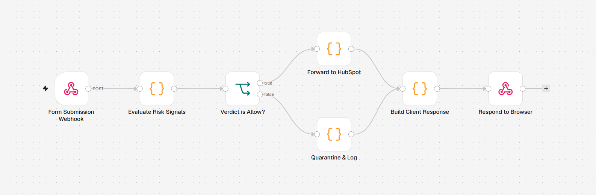

# n8n-hubspot-inbound-form-bot-honeypot-shield

A screening layer that sits in front of HubSpot form submissions. Every submission is scored on honeypot and timing traps, submission velocity, disposable email providers, gibberish and spam text, IP/ASN reputation, and browser header and UTM integrity. Clean leads are forwarded to the **HubSpot Forms API**. Everything else goes to a **quarantine review log**, where a person can release it.

It ships as two runtimes that share one scoring core:

- an **Express middleware** (`src/server.js`) with a review/release admin API and a JSONL review log;
- an **n8n workflow** (`workflows/hubspot-honeypot-shield.json`): Webhook → Evaluate → IF → HubSpot sync or Quarantine → Respond.

I built it so spam, bots, and throwaway addresses never reach the CRM, where they would consume contact tiers and enrichment credits and trigger automated sequences. It's also built to be safe to drop into a client environment: out of the box it makes **no outbound calls** and **forwards nothing**.

---

## Contents

1. [Safety defaults](#safety-defaults)
2. [Architecture](#architecture)
3. [Signals and scoring](#signals-and-scoring)
4. [Repository layout](#repository-layout)
5. [Quickstart](#quickstart)
6. [Front-end integration](#front-end-integration)
7. [Environment variables](#environment-variables)
8. [Review log and release API](#review-log-and-release-api)
9. [Importing the n8n workflow](#importing-the-n8n-workflow)
10. [Deployment guide](#deployment-guide)
11. [Going live checklist](#going-live-checklist)
12. [Testing](#testing)
13. [Limitations](#limitations)

---

## Safety defaults

| Setting | Default | Effect |
| --- | --- | --- |
| `DRY_RUN` | `true` | HubSpot submissions and quarantine webhooks are built and logged, never sent. |
| `SANDBOX_MODE` | `true` | With `DRY_RUN=false`, delivery is allowed only when `HUBSPOT_PORTAL_ID` equals `HUBSPOT_SANDBOX_PORTAL_ID`. |
| `ASN_LOOKUP_PROVIDER` | `none` | No IP reputation lookups, so no visitor IP leaves the machine. |
| HubSpot / webhook targets | placeholders | Live mode refuses to start (`503`) with a placeholder portal ID, form GUID, or hash salt. |
| `ADMIN_API_TOKEN` | placeholder | Admin endpoints return `404` until a real token of 24+ characters is set. |
| `SILENT_REJECT` | `true` | Blocked and quarantined submissions get the same `200 {"ok":true}` as accepted ones, so bots learn nothing. |
| Failed delivery | quarantine | If HubSpot rejects or the sandbox interlock refuses a clean lead, it is quarantined, not dropped. |

Flags are fail-safe: only `false`, `0`, `no`, or `off` disables them. `DRY_RUN=flase` stays in dry run.

---

## Architecture



```
          Visitor's browser (your site)
                 │  1. GET  /v1/form-token          → { renderedAt, token }   (signed render time)
                 │  2. POST /v1/submit  (JSON or urlencoded, hidden honeypot fields, hutk, pageUri, UTMs)
                 ▼
 ┌───────────────────────────────────────────────────────────────────────────┐
 │  Reverse proxy / CDN   (TLS, overwrites the client-IP header, optional ASN │
 │                         header such as x-client-asn)                      │
 └───────────────────────────────┬───────────────────────────────────────────┘
                                 ▼
 ┌───────────────────────────────────────────────────────────────────────────┐
 │  SHIELD  — Express (src/server.js)  or  n8n (Form Submission Webhook)     │
 │                                                                           │
 │  evaluateStage (src/core/shield.js)                                       │
 │   ├─ config check ............ live mode with placeholders → 503          │
 │   ├─ normalize ............... flat or HubSpot-style fields, IP, headers  │
 │   ├─ honeypot + timing ....... hidden fields, fill time, signed token     │
 │   ├─ form GUID allowlist                                                  │
 │   ├─ email ................... syntax, disposable domains                 │
 │   ├─ IP / ASN ................ CIDR lists, reserved ranges, datacenter ASN│
 │   ├─ velocity ................ per IP, per email domain, per mailbox      │
 │   ├─ text .................... entropy, keyboard smash, spam/LLM phrases  │
 │   ├─ browser + UTM ........... UA, Fetch Metadata, Origin, UTM integrity  │
 │   └─ decideVerdict ........... hard rules + score → allow│quarantine│block│
 │                                                                           │
 │        allow ─────────────┐                  ┌───────── quarantine / block│
 │                           ▼                  ▼                            │
 │  hubspotStage: DRY_RUN → intercept     quarantineStage: review record     │
 │  SANDBOX → portal pin                  (IP hashed), optional webhook      │
 │  failure → quarantineStage ───────────►   Express: data/quarantine.jsonl  │
 │                                            n8n: workflow static data      │
 │                                                                           │
 │  clientResponse → 200 {"ok":true,"status":"received"} (silent reject)     │
 └───────────────┬───────────────────────────────────────┬───────────────────┘
                 ▼                                       ▼
   HubSpot Forms API v3                      Review: GET /admin/quarantine
   /submissions/v3/integration/[secure/]     Release: POST /admin/quarantine/:id/release
   submit/{portalId}/{formGuid}
```

**n8n node map:** `Form Submission Webhook` → `Evaluate Risk Signals` (Code) → `Verdict is Allow?` (IF) → `Forward to HubSpot` (Code) or `Quarantine & Log` (Code) → `Build Client Response` (Code) → `Respond to Browser`.

The Code nodes are generated from `src/core/` by `scripts/build-n8n-workflow.js`. The tests rebuild the workflow, fail if it drifts, and execute the Code nodes to confirm they return the same verdicts, scores, and responses as the Express server.

---

## Signals and scoring

Each check adds points to a 0–100 risk score (capped at 100). **Hard rules** force a verdict regardless of score.

| Category | Signal | Points | Hard rule |
| --- | --- | --- | --- |
| Honeypot | `honeypot_filled`: a hidden field (`HONEYPOT_FIELDS`) has a value | 100 | block |
| Timing | `filled_too_fast`: under `MIN_FILL_SECONDS` after render | 45 | |
| Timing | `render_token_invalid`: render timestamp not signed by `FORM_TOKEN_SECRET` (only when a secret is set) | 40 | |
| Timing | `render_timestamp_future` / `render_timestamp_missing` / `form_stale` | 30 / 15 / 15 | |
| Form | `form_guid_not_allowed`: `formGuid` outside the allowlist | 100 | block |
| Email | `email_missing` / `email_invalid` | 100 | block |
| Email | `email_disposable`: bundled list (≈180 domains, subdomains matched) + `DISPOSABLE_DOMAINS_EXTRA` | 60 | block (or quarantine via `DISPOSABLE_EMAIL_ACTION`) |
| Velocity | `velocity_ip_exceeded`: more than `VELOCITY_MAX_PER_IP` in the window | 100 | block |
| Velocity | `velocity_domain_exceeded`: email-domain burst (separate, higher limit for free-mail domains) | 50 | quarantine |
| Velocity | `velocity_mailbox_exceeded`: same mailbox (plus-tags and Gmail dots collapsed) | 30 | quarantine |
| Text | `text_<field>`: sum of field signals, capped at 45 per field (see below) | ≤45 | |
| Text | `text_identical_fields`: first name, last name, company identical | 15 | |
| IP | `ip_blocklisted`: `IP_BLOCKLIST_CIDRS` | 100 | block |
| IP | `asn_datacenter`: hosting/cloud ASN (bundled list + `DATACENTER_ASNS_EXTRA`) | 35 | |
| IP | `ip_tor_exit` / `ip_anonymizer` / `ip_hosting` (ipinfo privacy data, when your plan includes it) | 40 / 20 / 30 | |
| IP | `ip_private_or_reserved` / `ip_unresolved` / `asn_header_missing` | 10 / 10 / 5 | |
| Browser | `ua_automation`: curl, python-requests, axios, headless Chrome, Selenium, Playwright, crawlers... | 70 | |
| Browser | `ua_missing` / `origin_not_allowed` / `origin_missing` | 40 / 50 / 20 | |
| Browser | `fetch_metadata_missing`: Chrome/Edge 80+ or Firefox 90+ without `Sec-Fetch-*` | 20 | |
| Browser | `accept_language_missing` / `ua_too_short` / `client_hints_missing` | 15 / 15 / 10 | |
| UTM | `utm_injection`: markup, script, template, or SQL syntax in UTM values | 35 | |
| UTM | `page_uri_foreign` / `utm_invalid_chars` | 20 / 15 | |
| UTM | `utm_incomplete` / `utm_mismatch` (form vs page URL) / `utm_overlong` / `utm_missing` (with `REQUIRE_UTM`) / `page_uri_invalid` | 10 each | |

**Free-text field signals** (for `TEXT_FIELDS_TO_SCORE`):

| Signal | Points | Applies to |
| --- | --- | --- |
| `keyboard_sequence`: 4+ characters from a keyboard row (QWERTY/QWERTZ/AZERTY, digits) | 30 | Latin-script text |
| `consonant_run`: 5+ consonants in a row | 25 | Latin-script text |
| `low_vowel_ratio`: under 15% vowels (6+ letters) | 20 | Latin-script text |
| `random_token`: 12+ characters, no spaces, Shannon entropy ≥ 3.7 bits/char | 30 | names, company |
| `repeated_characters` (4+ in a row) / `digits_in_name` / `url_in_name` / `overlong_name` | 20 / 15 / 40 / 15 | |
| `low_entropy_message` (< 2.5 bits/char) / `repetitive_words` / `too_many_urls` / `markup_links` / `shouting` / `overlong_message` | 20 / 15 / 20 / 30 / 10 / 10 | message |
| `llm_artifact` ("as an AI language model", "regenerate response") | 40 | message |
| `unfilled_template` ("[Your Name]", "{{first_name}}") | 35 | message |
| `classic_spam` / `crypto_pitch` / `seo_pitch` / `link_building` / `agency_pitch` / `generic_salutation` | 35 / 30 / 25 / 25 / 20 / 10 | message |

The Latin-script checks are skipped for names written mostly in other scripts, and the test suite includes real names in several languages (Polish, Vietnamese, Yoruba, isiXhosa, Irish, Chinese, Russian, Arabic, Japanese, Greek) that must score zero.

**Verdict:** any hard `block` → `block`; score ≥ `BLOCK_SCORE_THRESHOLD` (80) → `block`; any hard `quarantine` → `quarantine`; score ≥ `QUARANTINE_SCORE_THRESHOLD` (40) → `quarantine`; otherwise `allow`.

Allowlists: `IP_ALLOWLIST_CIDRS` skips IP and IP-velocity checks (office egress, QA rigs). `ALLOWLIST_EMAIL_DOMAINS` skips disposable and domain-velocity checks.

---

## Repository layout

```
.
├── README.md
├── LICENSE
├── DISCLAIMER.md
├── .env.example
├── .gitignore
├── package.json
├── src/
│   ├── server.js                  # Express middleware, admin API, --simulate
│   ├── quarantineStore.js         # JSONL review log with retention
│   └── core/                      # shared by Express and n8n (embedded into Code nodes)
│       ├── config.js              # env loader, fail-safe flags, live-mode validation
│       ├── shield.js              # stages: evaluate → hubspot | quarantine → response
│       ├── disposableDomains.js   # disposable + free-mail lists, syntax, canonical mailbox
│       ├── textHeuristics.js      # Shannon entropy, gibberish, spam/LLM patterns
│       ├── ipReputation.js        # IP parsing, CIDR lists, ASN providers, datacenter ASNs
│       ├── browserSignals.js      # UA, Fetch Metadata, Origin/Referer, UTM integrity
│       └── velocity.js            # sliding-window counters over a plain object
├── workflows/
│   └── hubspot-honeypot-shield.json   # generated, importable n8n workflow
├── scripts/
│   └── build-n8n-workflow.js
├── fixtures/
│   └── sample-submissions.json    # 7 synthetic submissions with expected verdicts
├── tests/
│   └── shield.test.js
└── data/
    └── .gitkeep                   # review log location (git-ignored)
```

---

## Quickstart

```bash
git clone https://github.com/dhrobinsystems/n8n-hubspot-inbound-form-bot-honeypot-shield.git
cd n8n-hubspot-inbound-form-bot-honeypot-shield
npm install

npm test           # 45 tests, no network
npm run simulate   # 7 fixtures end to end, DRY_RUN forced on
```

Expected simulation outcome:

| Fixture | Verdict |
| --- | --- |
| Clean inbound lead from a real browser | allow (forwarded, intercepted by dry run) |
| Honeypot field filled | block |
| Disposable email (mailinator) | block |
| Keyboard-smash gibberish | block |
| LLM-written SEO pitch with template placeholder and link stuffing | quarantine |
| Scripted flood (python-requests, 8× same IP) | block |
| Datacenter ASN from edge header, missing Accept-Language | quarantine |

The fixtures use RFC 5737 documentation IPs (`192.0.2.0/24`, `198.51.100.0/24`, `203.0.113.0/24`), so each also carries the small `ip_private_or_reserved` signal.

Run the server:

```bash
cp .env.example .env
npm start
# {"level":"info","msg":"server_started","port":3000,"dryRun":true,"sandboxMode":true,"asnProvider":"none",...}

curl -sS -X POST http://localhost:3000/v1/submit \
  -H 'Content-Type: application/json' \
  -H 'User-Agent: Mozilla/5.0 (Windows NT 10.0; Win64; x64) AppleWebKit/537.36 (KHTML, like Gecko) Chrome/130.0.0.0 Safari/537.36' \
  -H 'Accept-Language: en-US' -H 'Sec-Fetch-Mode: cors' -H 'Sec-Fetch-Site: same-site' -H 'Sec-CH-UA: "Chromium";v="130"' \
  -d "{\"email\":\"jane.doe@acme.example\",\"firstname\":\"Jane\",\"lastname\":\"Doe\",\"website_url\":\"\",\"_rendered_at\":\"$(( $(date +%s) - 30 ))000\"}"
# {"ok":true,"status":"received"}
```

The browser only ever sees `{"ok":true,"status":"received"}`. The verdict, score, and signals go to the server log as one JSON line per submission (no raw email or IP).

---

## Front-end integration

Point your custom form at the shield instead of HubSpot. Keep the honeypot inputs present in the DOM but invisible to people and to assistive technology.

```html
<form id="contact-form">
  <input name="email" type="email" required autocomplete="email">
  <input name="firstname" autocomplete="given-name">
  <input name="lastname" autocomplete="family-name">
  <input name="company" autocomplete="organization">
  <textarea name="message"></textarea>

  <!-- Honeypots: hidden from people, screen readers and tab order -->
  <div style="position:absolute;left:-10000px;width:1px;height:1px;overflow:hidden" aria-hidden="true">
    <label>Website <input name="website_url" tabindex="-1" autocomplete="off"></label>
    <label>Fax <input name="fax_number" tabindex="-1" autocomplete="off"></label>
  </div>

  <!-- consent checkbox wired into legalConsentOptions below -->
  <label><input name="consent" type="checkbox" required> I agree to the processing of my data.</label>
  <button type="submit">Send</button>
</form>

<script>
  const SHIELD = 'https://forms-shield.example.com'; // your shield origin
  const form = document.getElementById('contact-form');
  let render = { renderedAt: String(Date.now()), token: null };
  fetch(`${SHIELD}/v1/form-token`).then((r) => r.json()).then((t) => { render = t; }).catch(() => {});

  form.addEventListener('submit', async (event) => {
    event.preventDefault();
    const data = Object.fromEntries(new FormData(form));
    const params = new URLSearchParams(location.search);
    const hutk = (document.cookie.match(/(?:^|;\s*)hubspotutk=([^;]+)/) || [])[1];
    const payload = {
      ...data,
      _rendered_at: render.renderedAt,
      _render_token: render.token,
      hutk,
      pageUri: location.href,
      pageName: document.title,
      utm_source: params.get('utm_source') || undefined,
      utm_medium: params.get('utm_medium') || undefined,
      utm_campaign: params.get('utm_campaign') || undefined,
      legalConsentOptions: data.consent
        ? { consent: { consentToProcess: true, text: 'I agree to the processing of my data.' } }
        : undefined,
    };
    delete payload.consent;
    await fetch(`${SHIELD}/v1/submit`, { method: 'POST', headers: { 'Content-Type': 'application/json' }, body: JSON.stringify(payload) });
    form.replaceWith(Object.assign(document.createElement('p'), { textContent: 'Thanks! Your message has been received.' }));
  });
</script>
```

Notes:

- `legalConsentOptions` is forwarded to HubSpot unchanged. Copy the exact consent and subscription structure your HubSpot form expects (see HubSpot's Forms API documentation).
- HubSpot-style bodies (`{ "fields": [{ "name": "email", "value": "..." }], "context": { "hutk": "...", "pageUri": "..." } }`) are accepted as well as flat objects and `application/x-www-form-urlencoded`.
- Only fields in `FORWARD_FIELDS` reach HubSpot. Honeypots, timing fields, UTM values, and anything else are stripped.
- The visitor's IP is passed to HubSpot in `context.ipAddress`, as HubSpot's own embed does.

---

## Environment variables

| Variable | Default | Purpose |
| --- | --- | --- |
| `DRY_RUN` | `true` | Intercept HubSpot delivery and quarantine webhooks |
| `SANDBOX_MODE` | `true` | Live delivery only to `HUBSPOT_SANDBOX_PORTAL_ID` |
| `SILENT_REJECT` | `true` | Same 200 response for rejected submissions; `false` returns 422 / 429 |
| `PORT` | `3000` | Express port |
| `TRUST_PROXY` | `loopback` | Express `trust proxy`: hop count, proxy IPs/CIDRs, `true`/`false` |
| `BODY_LIMIT` | `64kb` | Max request body |
| `ALLOWED_ORIGINS` | — | Comma-separated origins for CORS and the Origin/Referer/pageUri checks |
| `ADMIN_API_TOKEN` | placeholder | Bearer token for `/admin/*` (24+ chars; placeholder disables admin) |
| `QUARANTINE_SCORE_THRESHOLD` / `BLOCK_SCORE_THRESHOLD` | `40` / `80` | Verdict thresholds |
| `HONEYPOT_FIELDS` | `website_url,fax_number` | Hidden trap fields |
| `FORM_TIMESTAMP_FIELD` / `FORM_TOKEN_FIELD` | `_rendered_at` / `_render_token` | Timing field names |
| `FORM_TOKEN_SECRET` | placeholder | HMAC secret for signed render timestamps (placeholder: unsigned accepted) |
| `MIN_FILL_SECONDS` / `MAX_FORM_AGE_SECONDS` | `3` / `7200` | Timing bounds |
| `VELOCITY_WINDOW_SECONDS` | `600` | Sliding window |
| `VELOCITY_MAX_PER_IP` | `5` | Hard block above this (0 disables) |
| `VELOCITY_MAX_PER_EMAIL_DOMAIN` / `VELOCITY_MAX_PER_FREEMAIL_DOMAIN` | `15` / `200` | Quarantine above these |
| `VELOCITY_MAX_PER_EMAIL` | `3` | Per canonical mailbox |
| `DISPOSABLE_EMAIL_ACTION` | `block` | `block` or `quarantine` |
| `DISPOSABLE_DOMAINS_EXTRA` / `ALLOWLIST_EMAIL_DOMAINS` | — | Extend the list / exempt domains |
| `TEXT_FIELDS_TO_SCORE` | `firstname,lastname,company,message` | Fields run through text heuristics |
| `MAX_URLS_IN_MESSAGE` | `2` | Above this adds `too_many_urls` |
| `ASN_LOOKUP_PROVIDER` | `none` | `none`, `header`, `ipinfo` |
| `ASN_HEADER` / `ASN_ORG_HEADER` | `x-client-asn` / `x-client-asn-org` | Header provider names |
| `IPINFO_TOKEN` / `IPINFO_TIMEOUT_MS` | placeholder / `1500` | ipinfo provider |
| `DATACENTER_ASNS_EXTRA` | — | More ASNs to treat as hosting (e.g. `AS12345,67890`) |
| `IP_BLOCKLIST_CIDRS` / `IP_ALLOWLIST_CIDRS` | — | IPv4 CIDRs or exact IPv4/IPv6 addresses |
| `CLIENT_IP_HEADER` | `x-forwarded-for` | **n8n only**: header carrying the visitor IP (use one your proxy overwrites; `none` disables) |
| `REQUIRE_UTM` | `false` | Add a signal when no UTM parameters are present |
| `HUBSPOT_PORTAL_ID` / `HUBSPOT_SANDBOX_PORTAL_ID` | placeholders | Target portal / sandbox pin |
| `HUBSPOT_FORM_GUID` / `HUBSPOT_ALLOWED_FORM_GUIDS` | placeholder / — | Default form / GUIDs a submission may choose via `formGuid` |
| `HUBSPOT_PRIVATE_APP_TOKEN` | placeholder | Optional: uses the authenticated `/secure/submit` endpoint |
| `HUBSPOT_FORMS_BASE_URL` / `HUBSPOT_TIMEOUT_MS` | `https://api.hsforms.com` / `8000` | API host / timeout |
| `FORWARD_FIELDS` | `email,firstname,lastname,company,phone,jobtitle,message,website` | Field allowlist sent to HubSpot |
| `QUARANTINE_LOG_PATH` / `QUARANTINE_RETENTION_DAYS` | `data/quarantine.jsonl` / `30` | Express review log |
| `QUARANTINE_HASH_SALT` | placeholder | Salt for hashing IPs in review records (required live) |
| `QUARANTINE_STORE_RAW_IP` | `false` | Keep raw IPs in review records (off by default) |
| `QUARANTINE_WEBHOOK_URL` | placeholder | Optional HTTPS notification target; Slack incoming webhooks get a one-line text summary, other URLs get the record as JSON |

---

## Review log and release API

Every `quarantine` and `block` verdict produces a review record:

```json
{
  "id": "1f0c...",
  "receivedAt": "2026-11-15T12:00:00.000Z",
  "verdict": "quarantine",
  "reason": "score_at_or_above_quarantine_threshold",
  "score": 55,
  "signals": [{ "category": "text", "id": "text_message", "points": 45, "hard": null, "detail": "llm_artifact, seo_pitch, unfilled_template, too_many_urls" }],
  "email": "outreach@growth-agency.example",
  "emailDomain": "growth-agency.example",
  "fields": { "firstname": "Sam", "message": "..." },
  "ipHash": "9b1d...",
  "ip": null,
  "asn": { "asn": null, "org": null, "source": "none" },
  "userAgent": "Mozilla/5.0 ...",
  "origin": null,
  "pageUri": null,
  "utm": {},
  "formGuid": null,
  "releasable": true
}
```

Express endpoints (Bearer `ADMIN_API_TOKEN`):

```bash
# list (newest first), optionally ?verdict=quarantine|block&limit=100
curl -sS http://localhost:3000/admin/quarantine -H "Authorization: Bearer $ADMIN_API_TOKEN"

# forward a reviewed submission to HubSpot (respects DRY_RUN and SANDBOX_MODE)
curl -sS -X POST http://localhost:3000/admin/quarantine/<id>/release -H "Authorization: Bearer $ADMIN_API_TOKEN"
```

- Honeypot hits are not releasable (`422`); a record can be released once (`409` after that).
- Released submissions are sent without `context.ipAddress` unless `QUARANTINE_STORE_RAW_IP=true`.
- The JSONL file is created with mode `0600`, compacted on startup to `QUARANTINE_RETENTION_DAYS`, and git-ignored.
- In n8n, the last 200 records live in workflow static data (`quarantineLog`), and `QUARANTINE_WEBHOOK_URL` can push each record to your own store (an n8n sub-workflow, a database endpoint, a Slack channel).

---

## Importing the n8n workflow

1. **Workflows → Import from File** → `workflows/hubspot-honeypot-shield.json`.
2. On the n8n host, set:
   - `NODE_FUNCTION_ALLOW_BUILTIN=crypto`
   - `N8N_BLOCK_ENV_ACCESS_IN_NODE=false`
   - the variables from `.env.example`, keeping `DRY_RUN=true` and `SANDBOX_MODE=true` at first
   - `CLIENT_IP_HEADER` set to a header your reverse proxy **overwrites** (`x-real-ip`, `cf-connecting-ip`). A client can forge `X-Forwarded-For` if the proxy appends to it instead.
3. Restart n8n, then test against `/webhook-test/hubspot-form-shield`.
4. Restrict CORS on the Webhook node (**Options → Allowed Origins**, where your n8n version offers it) to your site's origins, or enforce it at the reverse proxy.
5. Activate the workflow. Velocity counters and the quarantine log persist only for production (active) executions.

Notes:

- HubSpot and webhook calls go through `this.helpers.httpRequest` inside the Code nodes, so the dry-run and sandbox interlocks apply in n8n exactly as in Express. No n8n credentials are stored in the workflow.
- `saveDataSuccessExecution: none` keeps submitted personal data out of the execution list. Failed executions are saved; prune them on a schedule.
- Static data is per workflow and not shared across n8n queue-mode workers. For multi-worker setups, use the Express runtime or move velocity counters to a shared store.
- Don't edit the Code nodes by hand: change `src/core/`, run `npm run build:workflow`, and re-import.

---

## Deployment guide

**Process:** run `node src/server.js` under systemd, PM2, or a container (`node:20-alpine`, `npm ci --omit=dev`, `CMD ["node","src/server.js"]`). The process holds velocity counters in memory, so run one instance per site, or put a shared store behind `createVelocityTracker`'s interface before scaling out.

**Reverse proxy (nginx example):**

```nginx
server {
  listen 443 ssl http2;
  server_name forms-shield.example.com;
  # ssl_certificate / ssl_certificate_key ...

  client_max_body_size 64k;
  limit_req_zone $binary_remote_addr zone=forms:10m rate=30r/m;

  location / {
    limit_req zone=forms burst=10 nodelay;
    proxy_set_header Host $host;
    proxy_set_header X-Forwarded-For $remote_addr;   # overwrite, don't append
    proxy_set_header X-Forwarded-Proto $scheme;
    proxy_pass http://127.0.0.1:3000;
  }
}
```

With that proxy on the same host, keep `TRUST_PROXY=loopback`. Behind a CDN, set `TRUST_PROXY` to the number of proxy hops or to the CDN's published ranges.

**ASN data:** for `ASN_LOOKUP_PROVIDER=header`, have your edge add the visitor's ASN (for example a Cloudflare Worker setting `x-client-asn` from `request.cf.asn`) and strip any client-supplied copy. For `ipinfo`, add `IPINFO_TOKEN`, and disclose the IP sharing in your privacy notice.

**Render tokens:** set `FORM_TOKEN_SECRET` to a random 32+ byte value (`openssl rand -hex 32`) so bots can't fake a long fill time by sending an old timestamp.

---

## Going live checklist

1. **Dry run on real traffic.** Deploy with defaults, set `ALLOWED_ORIGINS`, `FORM_TOKEN_SECRET`, `ADMIN_API_TOKEN`, and `QUARANTINE_HASH_SALT`, point a test copy of the form at the shield, and read the logs and review log for a few days.
2. **Tune.** Adjust thresholds, `DISPOSABLE_EMAIL_ACTION`, velocity limits, and allowlists until real leads consistently score below 40.
3. **Sandbox delivery.** `DRY_RUN=false`, `SANDBOX_MODE=true`, with `HUBSPOT_PORTAL_ID` = `HUBSPOT_SANDBOX_PORTAL_ID` = your sandbox or test portal. Confirm contacts, consent, and the hutk/page attribution in HubSpot.
4. **Production.** Point `HUBSPOT_PORTAL_ID` at production, set `SANDBOX_MODE=false`, and keep reviewing the quarantine log, at least daily at first.
5. **Privacy.** Update the privacy notice (spam screening, IP processing, any ASN provider), and set a retention period you can defend.

---

## Testing

```bash
npm test
```

`tests/shield.test.js` (45 tests) covers:

- **Config:** fail-safe flags, placeholder detection, live-mode refusals, threshold validation, `503` on invalid config.
- **Email:** disposable list, subdomains, extras, allowlist, syntax, canonical mailbox, block vs quarantine action.
- **Text:** Shannon entropy, keyboard sequences, consonant runs, repeats, digits, random tokens, spam/LLM/template phrases, link markup, and multilingual names that must score zero.
- **IP/ASN:** CIDR matching, reserved ranges, header and ipinfo providers (including failure handling), no outbound call by default, blocklist and allowlist behaviour.
- **Browser/UTM:** automation UAs, missing headers, Fetch Metadata, Origin/Referer allowlist, UTM injection, incomplete, mismatch, and required.
- **Velocity and timing:** sliding window expiry, IP block, domain quarantine, free-mail limit, honeypot, fill-too-fast, signed and forged render tokens, verdict thresholds.
- **HubSpot and quarantine:** payload shape (fields allowlist, context, consent, secure vs unsecured endpoint), zero calls in dry run, sandbox portal refusal with quarantine fallback, delivery and HubSpot-rejection fallback, IP hashing, Slack summary format, non-HTTPS webhook refusal, silent reject.
- **Express:** health, CORS preflight, JSON and urlencoded bodies, honeypot → review log, `400`/`413`, admin auth, release under dry run, non-releasable honeypots, admin disabled without a token, retention compaction.
- **Fixtures:** all seven fixtures reach their expected verdicts with zero network calls.
- **n8n parity:** structure, credential scan, rebuild equality, and execution of the real Code nodes (through the IF branch) compared with the Express mirror for every fixture.

---

## Limitations

- **Heuristics, not certainty.** Every signal has false positives. Start in dry run, review, and tune before you trust automated blocking.
- **Lists go stale.** The disposable-domain and datacenter-ASN lists are a starting point. Extend them with the `*_EXTRA` variables or a maintained feed.
- **No MX or SMTP verification.** Mailbox existence checks are left out on purpose (outbound calls, privacy, and false negatives on catch-all domains).
- **In-memory velocity** (Express) and per-workflow static data (n8n) don't span multiple instances or workers.
- **Browser checks assume a direct browser post.** If another server relays submissions, forward the original headers or loosen the browser signals.
- **Not a WAF.** Keep rate limiting and TLS at the proxy, and keep the HubSpot form itself locked down (for example, don't publish the raw HubSpot embed alongside the shielded form).

---

## ⚠️ Disclaimer & Liability Limitation

**Use at your own risk.** The code, workflows, and scripts provided in this repository (`n8n-hubspot-inbound-form-bot-honeypot-shield`) are for educational and architectural demonstration purposes.

* **No Liability:** The author and dhRobin Systems assume no responsibility or liability for any direct, indirect, incidental, or consequential damages resulting from the use, misuse, or deployment of these scripts.
* **No Warranty:** All software, n8n JSON blueprints, and JavaScript modules are provided "AS IS" without warranty of any kind, express or implied, including but not limited to merchantability, fitness for a particular purpose, or non-infringement.
* **Production Testing Required:** Always test thoroughly in an isolated staging environment (for example a HubSpot developer test account or sandbox) with `SANDBOX_MODE=true` and `DRY_RUN=true` enabled before connecting live HubSpot credentials. Treat every blocked submission as a lead you may never see again, and review the quarantine log.
* **Detection Is Probabilistic:** Risk scores are heuristic. VPN users, corporate proxies, privacy-focused browsers, and people whose names don't fit English-language patterns can trigger signals, and determined bots can evade them.
* **Third-Party APIs & Compliance:** Users are solely responsible for complying with the terms of service, rate limits, data privacy regulations (GDPR/CCPA), and security policies of HubSpot and any connected services. That includes disclosing spam screening and IP processing in your privacy notice, confirming a lawful basis for any third-party IP lookups, forwarding every visitor's consent and subscription choices unchanged, and setting a retention period for the quarantine log.

The full disclaimer is also available in [DISCLAIMER.md](https://github.com/dhrobinsystems/n8n-hubspot-inbound-form-bot-honeypot-shield/blob/main/DISCLAIMER.md).

## License

Released under the MIT License. Copyright (c) 2026 DH Robin (dhRobin Systems). See [LICENSE](https://github.com/dhrobinsystems/n8n-hubspot-inbound-form-bot-honeypot-shield/blob/main/LICENSE).

Licensed under the MIT License. License: MIT © 2026 dhRobin Systems · Provided as-is, see the disclaimer.
